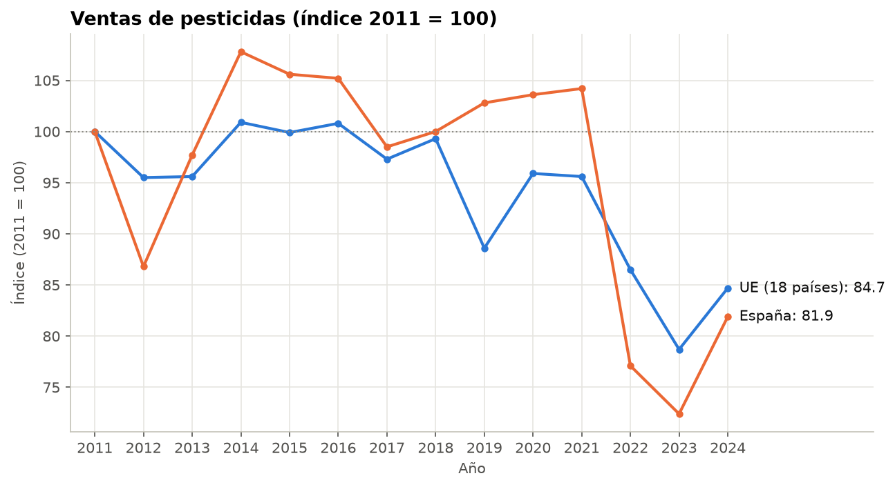
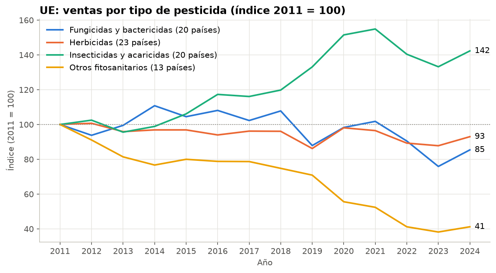
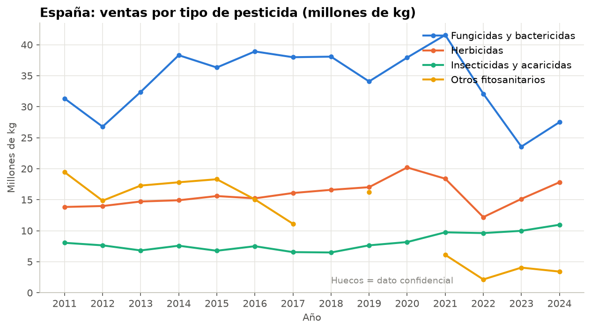
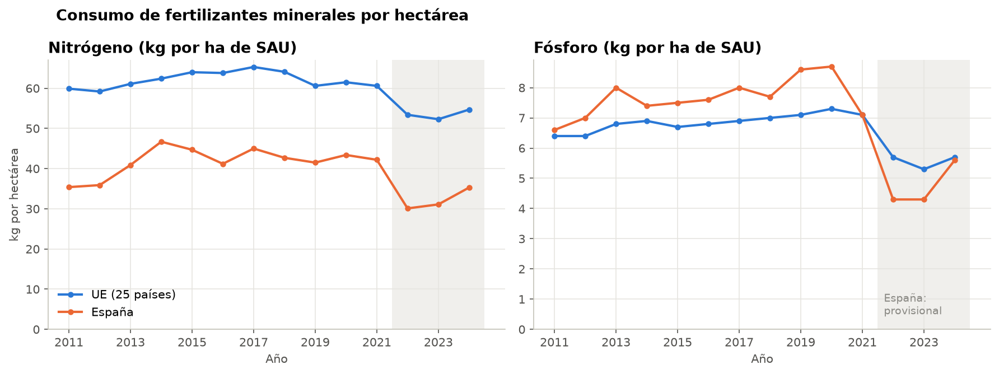
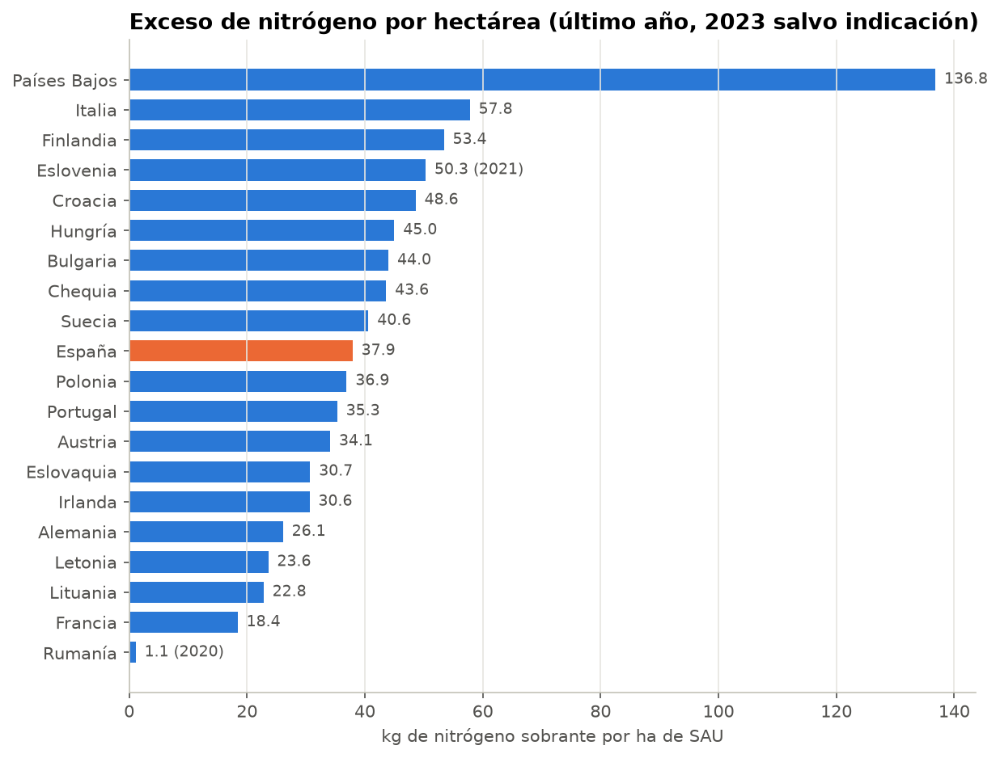
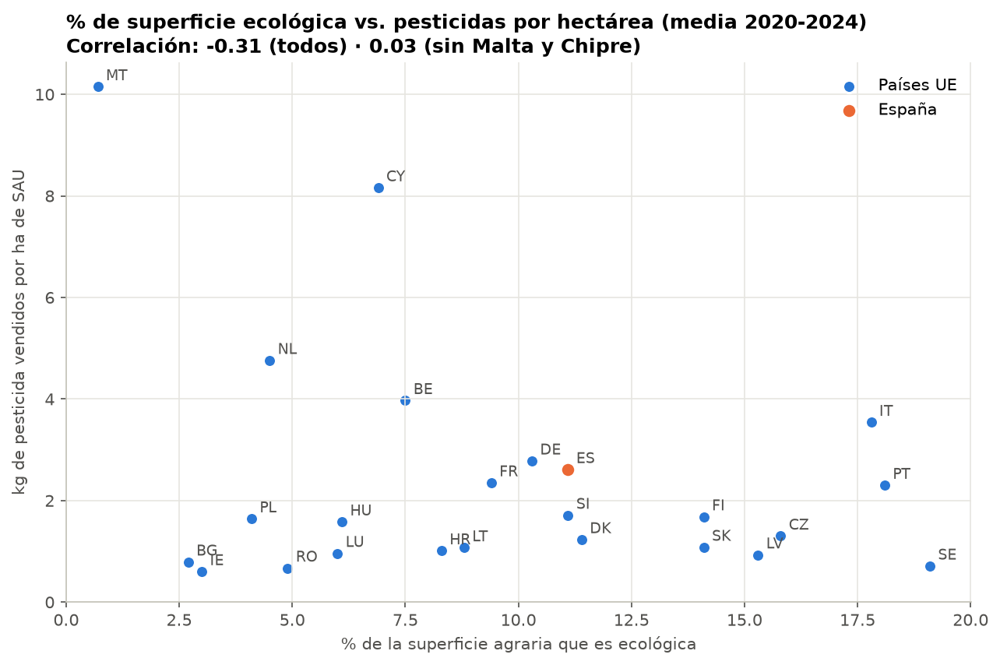
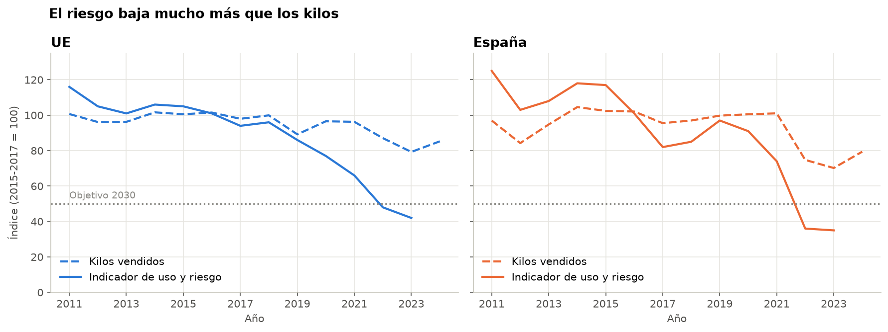
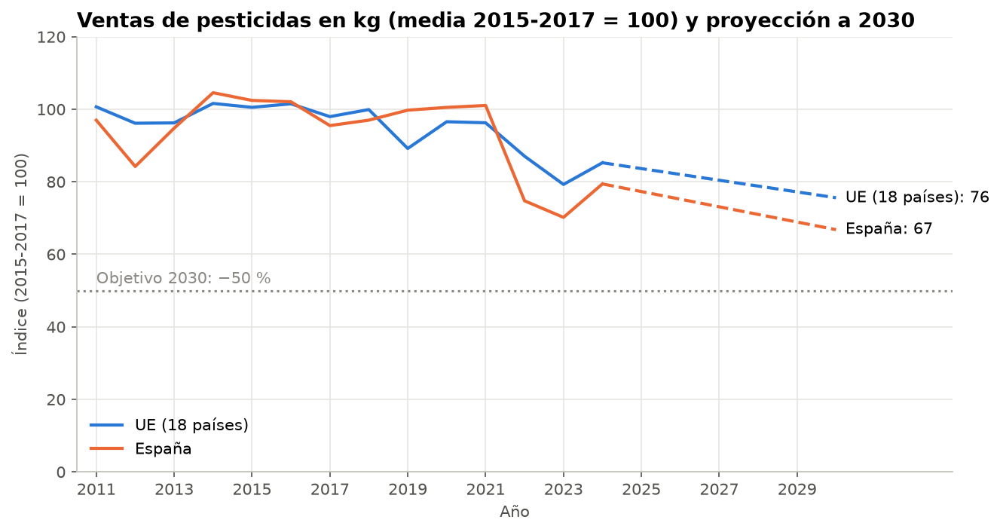
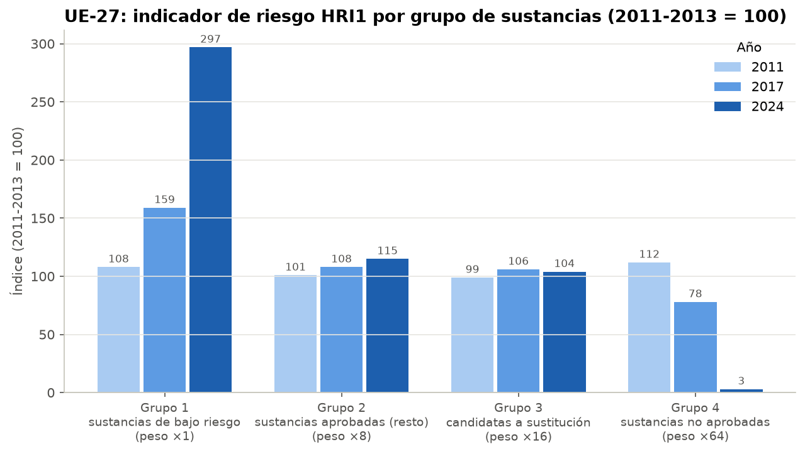

# 🧪 Pesticidas, fertilizantes y agricultura ecológica en la UE (2011-2024)

Proyecto de análisis de datos sobre el uso de **pesticidas y fertilizantes** en la Unión Europea y en España,
y su relación con la **agricultura ecológica**, con **datos oficiales de Eurostat**, **Python (pandas)**,
**SQL (SQLite)** y un **notebook de Jupyter**.

👉 **Análisis completo:** [`notebooks/analisis_pesticidas_fertilizantes.ipynb`](notebooks/analisis_pesticidas_fertilizantes.ipynb)

---

## 🎯 Objetivo

La estrategia europea *De la granja a la mesa* fija tres metas para 2030: reducir un **50 % el uso y riesgo de
pesticidas químicos** (respecto a 2015-2017), reducir un **20 % el uso de fertilizantes** y llegar a un **25 % de
superficie ecológica**. Este proyecto responde a cinco preguntas:

1. ¿Cómo han evolucionado las ventas de pesticidas en la UE y en España, en total y por tipo?
2. ¿Cómo ha evolucionado el consumo de fertilizantes minerales (nitrógeno y fósforo)?
3. ¿Qué países tienen mayor exceso de nitrógeno por hectárea?
4. ¿Los países con más superficie ecológica venden menos pesticidas por hectárea?
5. Al ritmo actual, ¿van la UE y España camino del objetivo de −50 % de pesticidas en 2030?

## 📊 Resultados principales

### 1. Las ventas de pesticidas, estables durante una década, bajan desde 2022



| Año | UE, 18 países (millones de kg) | Índice UE (2011 = 100) | España (millones de kg) | Variación anual España | Índice España (2011 = 100) |
|---|---:|---:|---:|---:|---:|
| 2011 | 332,37 | 100,0 | 73,11 | — | 100,0 |
| 2015 | 331,91 | 99,9 | 77,22 | −2,0 % | 105,6 |
| 2021 | 317,86 | 95,6 | 76,17 | +0,5 % | 104,2 |
| 2022 | 287,44 | 86,5 | 56,35 | **−26,0 %** | 77,1 |
| 2023 | 261,71 | 78,7 | 52,91 | −6,1 % | 72,4 |
| 2024 | 281,46 | **84,7** | 59,86 | +13,1 % | **81,9** |

*UE = suma de los 18 países con la serie completa 2011-2024 (Eurostat no publica el total UE; ver Limitaciones).*

- Entre 2011 y 2021 las ventas apenas cambian. La caída llega en **2022**: España vende un 26 % menos en un solo año.
- En 2024 las ventas están un **15,3 % por debajo de 2011 en la UE** y un **18,1 % en España**, con un repunte respecto a 2023.
- En 2024 España vende 59,86 millones de kg, el **21,3 %** del total de los 18 países.

**Por tipo de pesticida, los insecticidas suben y los "otros fitosanitarios" se desploman:**

<table>
<tr>
<td></td>
<td></td>
</tr>
</table>

| España | 2011 (millones de kg) | 2024 (millones de kg) | Cambio 2011-2024 | Índice UE 2024 (2011 = 100) |
|---|---:|---:|---:|---:|
| Fungicidas y bactericidas | 31,33 | 27,50 | −12,2 % | 85,4 |
| Herbicidas | 13,83 | 17,81 | +28,7 % | 93,0 |
| Insecticidas y acaricidas | 8,05 | 10,96 | **+36,2 %** | **142,3** |
| Otros fitosanitarios | 19,45 | 3,41 | **−82,5 %** | 41,2 |

- Los **fungicidas** son el grupo más vendido (45,9 % de los kg en España en 2024). Solo los **fungicidas inorgánicos** (azufre y cobre)
  suponen el 44,2 % de todos los kg vendidos en España (media 2020-2024).
- Los **insecticidas** crecen tanto en España (+36,2 %) como en la UE (índice 142,3).
- Los **otros fitosanitarios** (aceites, esterilizantes del suelo, rodenticidas...) son los que más caen.

### 2. Los fertilizantes caen en 2022, pero España vuelve a subir



| Indicador | 2011 | 2017 | 2021 | 2022 | 2024 |
|---|---:|---:|---:|---:|---:|
| UE, nitrógeno (kg/ha) | 59,9 | 65,3 | 60,6 | 53,4 | **54,7** |
| España, nitrógeno (kg/ha) | 35,4 | 45,0 | 42,2 | 30,1 *p* | **35,3** *p* |
| UE, fósforo (kg/ha) | 6,4 | 6,9 | 7,1 | 5,7 | **5,7** |
| España, fósforo (kg/ha) | 6,6 | 8,0 | 7,1 | 4,3 *p* | **5,6** *p* |

*UE = 25 países con serie completa (sin Chipre ni Malta). p = provisional.*

- El consumo crece hasta 2017 y cae con fuerza en **2022**, el año en que se dispararon los precios de los fertilizantes.
  En 2024 la UE usa un **10,0 % menos de nitrógeno** y un **12,8 % menos de fósforo** que en 2011.
- España usa **bastante menos nitrógeno por hectárea que la media de la UE** (35,3 frente a 54,7 kg/ha), pero tras la caída de 2022 se recupera:
  en 2024 consume un **3,0 % más de nitrógeno que en 2011**.

### 3. Países Bajos tiene, con diferencia, el mayor exceso de nitrógeno



| Ranking | País | Exceso de nitrógeno (kg/ha) | Año del dato |
|---:|---|---:|---:|
| 1 | **Países Bajos** | **136,8** | 2023 |
| 2 | Italia | 57,8 | 2023 |
| 3 | Finlandia | 53,4 | 2023 |
| 4 | Eslovenia | 50,3 | 2021 |
| 5 | Croacia | 48,6 | 2023 |
| 10 | España | 37,9 | 2023 |

*Exceso = balance bruto de nitrógeno (entradas − salidas) por hectárea de superficie agraria. Ranking de los 20 países con dato de 2020 o posterior.*

- **Países Bajos** tiene más del doble de nitrógeno sobrante que el segundo país, por su ganadería intensiva en poca superficie.
- Siete países no publican datos recientes. Con los de 2015, **Chipre (194), Malta (147), Bélgica (132) y Luxemburgo (129)**
  también tenían un exceso muy alto.
- **España** (37,9 kg/ha) está en el puesto 10 de 20, por debajo de la media.

### 4. Más superficie ecológica no significa menos kilos de pesticida



| País | % superficie ecológica | kg de pesticida por ha | % de fungicidas inorgánicos |
|---|---:|---:|---:|
| Suecia | 19,1 % | 0,71 | (confidencial) |
| Portugal | 18,1 % | 2,30 | 44,8 % |
| Italia | 17,8 % | 3,54 | 42,9 % |
| **España** | **11,1 %** | **2,61** | **44,2 %** |
| Países Bajos | 4,5 % | 4,76 | 2,6 % |
| Malta | 0,7 % | 10,15 | 59,8 % |

*Medias 2020-2024 de 24 países.*

- La correlación entre el % ecológico y los kg por hectárea es **−0,31**, débil. Además depende de **Malta y Chipre**:
  sin estas dos islas baja a **0,03**, es decir, ninguna relación.
- Los países mediterráneos tienen **mucho ecológico y muchos kg por hectárea**. Una explicación es que más del 40 % de sus kg son
  **azufre y cobre**, fungicidas que se aplican en dosis altas en viñedo, frutales y olivar y que **también están permitidos en ecológico**.
- ⚠️ **Correlación no es causalidad:** los países se diferencian en clima, cultivos y forma de registrar las ventas, y los kg no miden la peligrosidad.

### 5. El objetivo del −50 % ya se cumple en riesgo, pero no en kilos

<table>
<tr>
<td></td>
</tr>
</table>

| Medida (respecto a 2015-2017) | Último año | Cambio hasta hoy | Tasa anual media | **Cambio proyectado en 2030** | Tasa anual necesaria |
|---|---:|---:|---:|---:|---:|
| Indicador oficial de uso y riesgo, UE-27 | 2023 | **−58,0 %** | −11,7 % | ✅ objetivo cumplido | — |
| Indicador oficial de uso y riesgo, España | 2023 | **−65,0 %** | −13,9 % | ✅ objetivo cumplido | — |
| Kilos vendidos, UE (18 países) | 2024 | −14,8 % | −2,0 % | **−24,4 %** ❌ | −8,5 % |
| Kilos vendidos, España | 2024 | −20,6 % | −2,8 % | **−33,2 %** ❌ | −7,4 % |

*La proyección es una extrapolación aritmética («qué pasaría si todo sigue igual»), no un modelo predictivo.*



- Con el **indicador oficial** que usa la Comisión Europea, la UE-27 está en **42** y España en **35** (2015-2017 = 100). **El objetivo de 50 ya se ha alcanzado.**
  De los 16 países que publican el dato, 9 están ya en 50 o menos.
- En **kilos vendidos**, al ritmo actual España llegaría a 2030 con una reducción del 33,2 % y la UE del 24,4 %. Para llegar al −50 % en kilos,
  España tendría que reducir sus ventas un **7,4 % cada año** hasta 2030.



**¿Por qué tanta diferencia?** El indicador oficial pondera cada sustancia por su peligrosidad: las **no aprobadas** pesan ×64 y las de bajo riesgo ×1.
El índice de las sustancias no aprobadas cae de **112 a 3** entre 2011 y 2024, mientras que el de las de bajo riesgo pasa de 108 a 297.
Se venden casi los mismos kilos, pero de **productos menos peligrosos**.

## 💡 Conclusiones

- **El objetivo de pesticidas depende de cómo se mida.** Con el indicador oficial de uso y riesgo, la UE (−58 %) y España (−65 %) **ya han superado
  el −50 %**, gracias a la retirada de las sustancias más peligrosas. En kilos, la reducción es mucho menor (−14,8 % y −20,6 %) y, al ritmo actual,
  no llegaría al −50 % en 2030.
- **Los insecticidas crecen** (+36,2 % en España desde 2011) mientras caen los "otros fitosanitarios", y los fungicidas (sobre todo azufre y cobre)
  siguen siendo el grupo principal.
- **Fertilizantes:** la caída de 2022 coincide con la subida de precios, no con un cambio de tendencia claro. España usa poco nitrógeno por hectárea,
  pero en 2024 ya supera el nivel de 2011.
- **El exceso de nitrógeno se concentra en países con ganadería intensiva:** Países Bajos tiene 136,8 kg de nitrógeno sobrante por hectárea, frente a 37,9 en España.
- **Entre países, más ecológico no significa menos kilos de pesticida:** la relación es débil y los países mediterráneos, con mucho ecológico,
  usan mucho azufre y cobre.

---

## 🗂️ Datos

**Fuente:** [Eurostat](https://ec.europa.eu/eurostat), la oficina estadística de la Unión Europea.
Se **descargan automáticamente** desde la API pública de Eurostat. En [`data/raw/fuente_datos.json`](data/raw/fuente_datos.json)
están los códigos, las URL y la fecha de descarga.

| Tabla Eurostat | Contenido | Periodo usado |
|---|---|---|
| [`aei_fm_salpest09`](https://ec.europa.eu/eurostat/databrowser/view/aei_fm_salpest09/default/table) | Ventas de pesticidas por tipo (kg) | 2011-2024 |
| [`sdg_02_53`](https://ec.europa.eu/eurostat/databrowser/view/sdg_02_53/default/table) | Uso y riesgo de pesticidas químicos (índice 2015-2017 = 100) | 2011-2023 |
| [`aei_hri`](https://ec.europa.eu/eurostat/databrowser/view/aei_hri/default/table) | Indicador de riesgo HRI1 por grupo de sustancias (2011-2013 = 100) | 2011-2024 |
| [`aei_fm_usefert`](https://ec.europa.eu/eurostat/databrowser/view/aei_fm_usefert/default/table) | Consumo de fertilizantes minerales (t de N y P) | 2011-2024 |
| [`aei_pr_gnb`](https://ec.europa.eu/eurostat/databrowser/view/aei_pr_gnb/default/table) | Balance bruto de nutrientes (kg/ha) | 2011-2023 |
| [`sdg_02_40`](https://ec.europa.eu/eurostat/databrowser/view/sdg_02_40/default/table) | % de la superficie agraria que es ecológica | 2011-2024 |
| [`apro_cpsh1`](https://ec.europa.eu/eurostat/databrowser/view/apro_cpsh1/default/table) | Superficie agraria utilizada, SAU (para calcular kg/ha) | 2011-2024 |

**Limitaciones:**

- **Pesticidas: no hay total UE y hay datos confidenciales.** Eurostat no publica un agregado UE de ventas, y 9 países tienen años
  confidenciales o sin dato (Estonia solo publica 1 de 14 años; Bulgaria 4; Malta 5; Polonia 10). Por eso el "total UE" es la suma de los
  **18 países con serie completa**. En España, los molusquicidas y los reguladores del crecimiento son confidenciales casi todos los años, y muchas
  clases de nivel inferior (por ejemplo, los esterilizantes del suelo) también.
- **Indicador oficial de riesgo:** muchos países no publican su valor (solo 16 tienen dato en 2023), aunque sí cuentan en el total UE-27.
- **Fertilizantes:** el total oficial UE-27 llega a 2019 (la suma de 25 países se diferencia como máximo un 2,4 % de él). Chipre no tiene datos desde 2020
  y los de España de 2022-2024 son provisionales.
- **Balance de nitrógeno:** el total UE-27 solo llega a 2014; Bélgica, Chipre, Dinamarca, Grecia, Luxemburgo y Malta no publican desde 2015, y Estonia desde 2012.
  Esos datos antiguos son estimados.
- **Kilos vendidos ≠ kilos aplicados:** las ventas no reflejan exactamente el uso en el campo ni la toxicidad de cada producto.

## 🛠️ Herramientas

| Herramienta | Uso en el proyecto |
|---|---|
| **Python** (urllib) | Descarga automática desde la API de Eurostat |
| **Python** (pandas) | Limpieza y transformación de datos |
| **SQL** (SQLite) | Modelo de datos en estrella y consultas de análisis |
| **Jupyter Notebook** | Análisis, tablas y conclusiones |
| **matplotlib** | Gráficos |

## 🔄 Proceso

```
 01_descargar_datos.py   02_limpieza.py          03_cargar_sql.py         notebook
┌───────────────┐      ┌──────────────────┐     ┌────────────────┐     ┌────────────────────┐
│ API Eurostat  │ ───> │ data/processed/  │ ──> │ SQLite (.db)   │ ──> │ análisis, gráficos │
│ → data/raw/   │      │ modelo estrella  │     │ esquema + datos│     │ → data/output/     │
└───────────────┘      └──────────────────┘     └────────────────┘     └────────────────────┘
```

### 1. Limpieza de datos (pandas)

| Problema | Ejemplo | Solución |
|---|---|---|
| Varias dimensiones en una columna | `A,TOTAL,KG,ES` | `str.split(",", expand=True)` |
| Un año en cada columna | `2011 │ 2012 │ … │ 2024` | `melt()` a formato largo |
| Notas pegadas al número | `744072 p` (provisional) | Expresión regular: número + nota |
| Valores sin dato | `:` | Se eliminan |
| Valores confidenciales | `: @C` | Se guardan con valor vacío y nota `c`, para poder contarlos |
| Unidades distintas | SAU en miles de ha | Se pasa a hectáreas |
| Códigos poco legibles | `F01`, `BAL_UAA`, `GRP4` | Diccionarios de traducción al español |
| Regiones y países de fuera de la UE | `ES11`, `CH`, `UK` | Filtrar UE-27 |

Notas de Eurostat: `e` estimado, `p` provisional, `b` ruptura de serie, `d` definición distinta, `u` baja fiabilidad, `c` confidencial.

### 2. Modelo de datos (SQL)

```
                     ┌──< fact_ventas_pesticidas >── dim_tipo_pesticida
                     ├──< fact_riesgo_pesticidas
                     ├──< fact_riesgo_grupos      >── dim_grupo_riesgo
      dim_pais 1 ────┼──< fact_fertilizantes      >── dim_nutriente
                     ├──< fact_balance_nutrientes >── dim_nutriente
                     ├──< fact_sau
                     └──< fact_pct_ecologica
```

| Tabla | Columnas principales |
|---|---|
| `dim_pais` | codigo_pais, pais, es_agregado |
| `dim_tipo_pesticida` | codigo_pesticida, tipo_pesticida, nivel, codigo_grupo, grupo |
| `dim_nutriente` | codigo_nutriente, nutriente |
| `dim_grupo_riesgo` | codigo_grupo_riesgo, grupo_riesgo, ponderacion |
| `fact_ventas_pesticidas` | año, codigo_pais, codigo_pesticida, kg, nota |
| `fact_riesgo_pesticidas` | año, codigo_pais, indice_2015_2017, nota |
| `fact_riesgo_grupos` | año, codigo_pais, codigo_grupo_riesgo, indice_2011_2013, nota |
| `fact_fertilizantes` | año, codigo_pais, codigo_nutriente, toneladas, nota |
| `fact_balance_nutrientes` | año, codigo_pais, codigo_nutriente, balance_kg_ha, nota |
| `fact_sau` | año, codigo_pais, sau_ha, nota |
| `fact_pct_ecologica` | año, codigo_pais, pct_sau_ecologica, nota |

Vistas: `v_pesticidas_por_grupo`, `v_pesticidas_kg_ha` y `v_fertilizantes_kg_ha`.

### 3. Consultas SQL

En [`sql/02_consultas_analisis.sql`](sql/02_consultas_analisis.sql) hay 12 consultas que practican `JOIN`,
`GROUP BY`, `HAVING`, `CASE`, subconsultas, CTE (`WITH`) y funciones ventana (`LAG`, `RANK`, `FIRST_VALUE`,
`SUM() OVER`). El notebook las carga por su nombre, muestra el SQL y ejecuta cada una. Ejemplo: el "total UE" de
pesticidas, sumando solo los países con los 14 años publicados:

```sql
WITH paises_serie_completa AS (
    SELECT codigo_pais
    FROM fact_ventas_pesticidas
    WHERE codigo_pesticida = 'TOTAL'
    GROUP BY codigo_pais
    HAVING COUNT(kg) = 14              -- COUNT(kg) no cuenta los NULL (confidenciales)
)
SELECT
    v.año,
    COUNT(*)                                                               AS num_paises,
    ROUND(SUM(v.kg) / 1e6, 2)                                              AS millones_kg_ue,
    ROUND(100.0 * SUM(v.kg) / FIRST_VALUE(SUM(v.kg)) OVER (ORDER BY v.año), 1) AS indice_ue_2011
FROM fact_ventas_pesticidas AS v
JOIN paises_serie_completa  AS c ON c.codigo_pais = v.codigo_pais
WHERE v.codigo_pesticida = 'TOTAL'
GROUP BY v.año;
```

## 📁 Estructura del proyecto

```
Proyecto DATA Agro_2/
├── data/
│   ├── raw/                 # Archivos originales de Eurostat (.tsv) + fuente_datos.json
│   ├── processed/           # Datos limpios en modelo estrella (.csv)
│   └── output/              # Resultados de las consultas SQL y de la proyección (.csv)
├── database/                # Base de datos SQLite (se genera, no se sube a GitHub)
├── images/                  # Gráficos generados por el notebook
├── notebooks/
│   └── analisis_pesticidas_fertilizantes.ipynb   # ⭐ Análisis y resultados
├── scripts/
│   ├── 01_descargar_datos.py  # Descarga desde la API de Eurostat
│   ├── 02_limpieza.py         # Limpieza y transformación con pandas
│   └── 03_cargar_sql.py       # Crea la base de datos y carga las tablas
├── sql/
│   ├── 01_esquema.sql            # Tablas, claves y vistas
│   └── 02_consultas_analisis.sql # 12 consultas de análisis
├── main.py                  # Ejecuta todo el proceso en orden
├── requirements.txt
└── README.md
```

## 🚀 Cómo ejecutarlo

Requisitos: Python 3.10 o superior y conexión a internet (para la primera descarga).

```bash
# 1. Crear y activar un entorno virtual
python -m venv .venv
.venv\Scripts\activate          # Windows
# source .venv/bin/activate     # macOS / Linux

# 2. Instalar dependencias
pip install -r requirements.txt

# 3. Ejecutar todo (descarga → limpieza → SQL → notebook)
python main.py

# Para volver a descargar los datos más recientes de Eurostat:
python scripts/01_descargar_datos.py --actualizar
```

Los datos de este repositorio se descargaron el **7 de noviembre de 2026**.

## 👤 Autor

**[Samuel Anaya Garcia]** – [LinkedIn](www.linkedin.com/in/samuel-anaya-garcia) · [GitHub](https://github.com/SamAnaya11)
